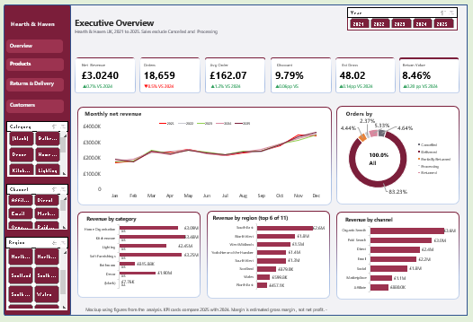
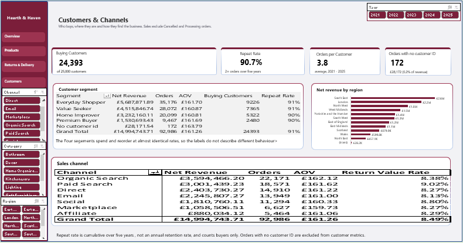

# Retail Business Performance Analysis to Identify Revenue Gaps, Margin Leaks and Operational Opportunities for Hearth & Haven UK, 2021-2025

An Excel analysis and four-page interactive dashboard for a fictional UK home-goods retailer. It looks for revenue gaps (flat sales and a weak start to the year), margin leaks (deep discounts and high-cost products) and operational opportunities (returns, delivery and data capture), and sets out what to test first. Built with Power Query, the Excel Data Model, DAX measures, PivotTables and slicers.

> **Data note:** the company and all data are fictional and synthetic, created for portfolio use.

## Project Overview

| Element | Description |
|---|---|
| Company | Hearth & Haven UK, a fictional online retailer of home goods |
| Industry | UK e-commerce, home and living |
| Project type | Descriptive and diagnostic analytics, with hypothesis testing |
| Role | Data analyst (portfolio project) |
| Objective | Find where margin and returned revenue are lost, and which actions to test first |
| Tools | Excel, Power Query, Excel Data Model, DAX, PivotTables, slicers |
| Dataset | Synthetic, four related tables: 200,000 order lines, 100,000 orders, 25,000 customers, 420 products; 1 January 2021 to 31 December 2025 |
| Stakeholders | Head of E-commerce, Merchandising Manager, Finance lead, Customer Experience and Operations leads |
| Deliverables | Four-page interactive dashboard, documentation workbook, findings report, case study |

## Business Context

Hearth & Haven UK sells home goods in six categories (kitchenware, soft furnishings, lighting, decor, bathroom and home organisation) sourced from eight suppliers. It earns revenue from item sales, after discounts of up to 30%, plus shipping charges recorded separately. Orders arrive through seven channels (organic and paid search, direct, email, social, marketplace and affiliate) and ship by Standard, Express or Click & Collect. Customers can return items, and returns are recorded with a customer-stated reason.

Over the five years the business took about 93,000 sales orders from 25,000 customers, with net revenue of £14.99M, an average order value of £161 and an estimated gross margin of 48%. Success for a business like this means growing revenue at a healthy margin, keeping returns low, and delivering reliably. The challenges visible in the data are flat revenue, heavy discounting, a large returns bill and delivery performance that nobody can currently measure against a promise.

## Problem Statement

Net revenue stayed at about £3.0M a year from 2021 to 2025 (+1.7% in four years), while 63% of order lines carried a discount and returns equalled 8.5% of net revenue (£1.27M). Management cannot see where margin and returned revenue are being lost, whether by discount depth, category, supplier, channel or delivery, which makes it hard to decide what to fix first.

## Business Objectives

1. Establish how revenue, orders and estimated margin changed over time, and whether the year has a consistent shape.
2. Measure what discounting does to margin and to the size of an order.
3. Explain why margin differs between categories and suppliers.
4. Quantify returns, find where they concentrate, and see what customers say about them.
5. Check whether delivery performance differs by shipping method, region or month.
6. Test whether customer segments behave differently.

## Executive Summary

Hearth & Haven UK is a fictional online home-goods retailer whose revenue has been flat since 2021. This project analysed five years of order, customer and product data to find where margin and returned revenue are being lost. It covers trends, discounts, categories and suppliers, returns, delivery and customers, and excludes marketing spend, website traffic, stock levels and net profit, which the data does not hold.

Three findings matter most. First, revenue barely moved (£2.97M in 2021 to £3.02M in 2025) and 32% of it arrives in October to December in every category and channel. Second, deeper discounts cut estimated margin from 53.0% at full price to 35.8% in the deepest band while units per line stay at 1.40 to 1.41, and the margin gaps between categories and suppliers come from product cost relative to price, not from discounting. Third, returns cost £1.27M (8.49% of net revenue), and customers cite reasons the business can influence for 59% of it. Delivery looks identical everywhere (5.7 days), even for Express, which costs about £4.76 more per order than Standard.

My recommendation is to test before acting: run a controlled test of the deeper discount bands, replace estimated costs with real ones for the weakest categories and suppliers, audit the avoidable return reasons, and record a promised delivery date so delivery can be measured. If the tests confirm these patterns, the business would protect margin on discounted lines, recover part of the £592K of avoidable returned value and gain a measurable on-time delivery KPI. The analysis sizes these opportunities but does not forecast gains.

## Project Scope

| Included | Excluded |
|---|---|
| Revenue, orders and estimated margin by month and year | Marketing return, acquisition cost and conversion (no spend or traffic data) |
| Seasonality overall, by category and by channel | Stock levels and stockouts (no inventory data) |
| Discount depth against margin and basket size | Net profit (no overheads, fulfilment or marketing cost) |
| Category, supplier, channel and region contribution | On-time delivery rate (no promised delivery date) |
| Returns by reason, category, product, channel and delivery time | Competitor pricing and external market research |
| Delivery lead time by method, region and month | Forecasting beyond five annual cycles |
| Customer segments and repeat purchasing | |
| Data quality issues and their effect on the numbers | |

## Dataset and Data Dictionary

| Item | Detail |
|---|---|
| Source | Synthetic dataset supplied with the project brief |
| Tables | Four (order items, orders, customers, products), plus a Calendar table I added |
| Records | 200,000 order lines, 100,000 orders, 25,000 customers, 420 products |
| Columns | 15 (order items), 10 (orders), 8 (customers), 7 (products) |
| Date range | 1 January 2021 to 31 December 2025 |
| Format | Excel workbook, one sheet per table |
| Unit of analysis | The order line, rolled up to orders and customers |

Key columns (the full dictionary, with every column and the fields I added, is in the [documentation workbook](docs/HearthHaven_Documentation.xlsx)):

| Column | Description | Data type |
|---|---|---|
| OrderItemID | Unique ID of an order line | Text |
| OrderID | Order the line belongs to | Text |
| ProductID | Product on the line | Text |
| Quantity | Units on the line | Whole number |
| DiscountRate | Discount as a fraction of gross value (0 to 0.30) | Decimal |
| NetItemRevenue_GBP | Gross value less discount; the revenue measure | Decimal |
| EstimatedGrossMargin_GBP | Net revenue less estimated product cost | Decimal |
| ReturnedValue_GBP | Value of returned units | Decimal |
| ReturnReason | Customer-stated reason for a return | Text |
| OrderDate / DeliveryDate | Dates the order was placed and delivered | Date |
| OrderStatus | Delivered, Returned, Partially Returned, Cancelled, Processing | Text |
| SalesChannel / ShippingMethod | How the order arrived and how it shipped | Text |
| CustomerSegment | One of four customer labels | Text |
| Category / Supplier | Product category and supplier | Text |

## Tools and Technologies

| Tool | Application |
|---|---|
| Excel | PivotTables and PivotCharts for analysis, slicers for filtering, dashboard layout, GETPIVOTDATA to link KPI cards to pivots |
| Power Query | Removing duplicates, trimming and standardising text, converting types with a UK locale, adding flag and band columns with conditional logic, recovering blank discount rates; every step is recorded and repeatable, and the raw data is never edited |
| Excel Data Model | One-to-many relationships between four tables, and a Calendar table linked to order dates for year, quarter and month analysis |
| DAX | Measures built with CALCULATE (sales-status filters), DIVIDE, DISTINCTCOUNT, FILTER and VALUES (customer counts), SAMEPERIODLASTYEAR (year-on-year change) and ALL (share of lines) |

## Data Cleaning and Preparation

The raw file was never edited. Every fix is a Power Query step, and the issue log holds 27 entries.

| Issue | Resolution | Reason |
|---|---|---|
| 80 duplicate order lines | Removed | Same ID and values, so they double-counted (-£5,883, 0.04%) |
| 35 dates written day first among year-first dates | Parsed as UK dates before any other date step | An automatic month-first conversion blanked 18 sales orders (£2,916) from the yearly totals |
| 67 order statuses spelled several ways | Standardised to five statuses | Needed for the sales filter; five cancelled or processing orders (£682) were counted as sales until fixed |
| 300 sales channels with spaces or lowercase | Trimmed and proper-cased | Prevents split channel rows |
| 250 blank discount rates | Recovered from discount value divided by gross value | Rates are multiples of 5% and match the value columns |
| 160 lines with zero quantity | Kept and flagged | The money columns reconcile, so the quantity looks wrong, not the value |
| 10 lines returning more units than ordered | Kept and flagged | Cannot tell which field is wrong |
| 110 lines with no matching product | Kept in totals as "unmapped", excluded from category and product views | No product details exist (£7,760, 0.05% of sales) |
| 180 orders with no customer ID | Kept in revenue and orders, excluded from customer metrics | The ID cannot be recovered (172 sales orders, £28,172) |
| 12 orders delivered before they were placed | Flagged, lead time left blank | Breaks the date rule |
| 420 products share 223 names | Ranked by ProductID | Ranking by name made returns look about twice as concentrated |
| Cancelled and Processing orders | Excluded from sales | Not completed sales; this moved net revenue by £1.13M (7.0%), far more than any error |

## Analytical Methodology

- **Descriptive analytics:** revenue, orders, average order value and margin by month, year, category, supplier, channel and region.
- **Trend and seasonality analysis:** each month's share of the year, and the December to January ratio, overall and for every category and channel.
- **Diagnostic analysis:** margin by discount band and category, product cost as a share of gross value, return rates by reason, channel and delivery time.
- **Root cause investigation:** for the margin gaps, I tested category mix, discount mix and cost ratio in turn.
- **Comparative analysis:** shipping methods, regions and months for delivery time.
- **Segmentation:** customer segments by spend and repeat purchasing.
- **Statistical checks:** simple resampling and proportion tests, run outside Excel, to judge whether differences between small groups were more than normal variation.

### Hypotheses tested

The five starting hypotheses come from the project brief. I tested each against the cleaned data.

| # | Hypothesis | Verdict | What the data showed |
|---|---|---|---|
| 1 | Revenue and orders vary by season, channel, region or category | **Partly supported** | Season matters, but every category and channel has the same shape, and yearly revenue is flat |
| 2 | Discounting supports volume but reduces margin | **Margin: supported. Volume: not shown** | Margin falls 17 points across the discount range, with no larger baskets |
| 3 | Returns are concentrated in particular products, categories, channels or delivery outcomes | **Mostly not supported** | Spread widely; only Paid Search stands out |
| 4 | Delivery performance differs by shipping method, region or period | **Not supported, and dropped** | 5.7 days for every method, region and month, so I dropped it as an explanation for anything else |
| 5 | Reference data has quality problems that affect accuracy | **Supported** | 27 log entries; three moved headline numbers |

Hypotheses 3 and 4 did not hold up, and that is a useful result: the business should not spend effort hunting for a few problem products or a slow shipping method.

## KPI Framework

| KPI | Definition | Business purpose | 2021 to 2025 |
|---|---|---|---|
| Net item revenue | Sum of net item revenue on sales orders | Measure sales performance | £14,994,744 |
| Gross item value | Sum of quantity times unit price, before discount | Base for the discount rate | £16,612,937 |
| Discount rate | Total discount value divided by total gross value (weighted) | Measure how much value is given away | 9.74% |
| Estimated gross margin | Net revenue less estimated product cost | Measure what is left after product cost | £7,193,232 |
| Estimated gross margin % | Estimated margin divided by net revenue | Compare margin across groups | 47.97% |
| Return value rate | Returned value divided by net revenue | Measure the cost of returns | 8.49% |
| Returned unit rate | Returned units divided by units sold | Cross-check returns by volume | 8.47% |
| Order count | Distinct orders on sales order lines | Measure demand | 92,986 |
| Average order value | Net revenue divided by orders | Measure spend per order | £161.26 |
| Average lead time | Days from order to delivery, delivered orders only | Measure delivery speed | 5.69 days |
| Customer repeat rate | Customers with 2 or more orders divided by buying customers | Measure repeat behaviour (cumulative) | 90.7% |
| On-time delivery rate | Not calculated | Needs a promised delivery date, which the data lacks | n/a |

"Sales" means every order status except Cancelled and Processing. Full definitions are in the documentation workbook.

## Dashboard and Decision Support

| Page | Question it answers | Decision it supports | Main user |
|---|---|---|---|
| 1. Overview | How are revenue, orders and margin moving, and when? | Capacity and marketing planning | Head of E-commerce |
| 2. Products and Margin | Where does margin come from, and what do discounts cost? | Discount policy, pricing and supplier review | Merchandising and Finance |
| 3. Returns and Delivery | Why do customers return items, and how fast do orders arrive? | Returns reduction and delivery service | Customer Experience and Operations |
| 4. Customers and Channels | Who buys, from where, and do they come back? | Customer and channel focus | Head of E-commerce |

Each page has four slicers (Year, Channel, Region, Category), and the KPI cards compare the selected year with the previous one.

## Analysis and Key Findings

### 1. Revenue is flat, and a third of it arrives in October to December

- **Finding.** Net revenue barely moved, and the year has the same shape in every category and channel.
- **Evidence.** Net revenue rose from £2,974,639 (2021) to £3,024,041 (2025), +1.7%. Orders rose 0.8% (18,513 to 18,659) and average order value 0.9% (£160.68 to £162.07). October to December brings 32.3% of revenue and January and February 12.2%. December is 1.95 times January overall and 1.85 to 2.10 times in every category and channel, and most of those differences are within normal variation.
- **Interpretation.** Neither volume nor basket size is growing, and the seasonal peak is a business-wide calendar effect, not a product or channel story.
- **Business impact.** Stock, staffing, returns handling and marketing have to be sized for three months of the year, and January and February are consistently quiet.
- **Action.** Plan capacity around the peak and test ways to lift January and February.

### 2. Deeper discounts cut margin without larger baskets

- **Finding.** Estimated margin falls steeply as discounts deepen, and baskets do not grow in return.
- **Evidence.** Margin is 53.0% at no discount, then 49.0%, 43.3% and 35.8% in the 5 to 10%, 15 to 20% and 25 to 30% bands, a fall of about 17 points in every category. Units per line stay at 1.40 to 1.41 and product cost per line at about £42 in every band. About 63% of lines are discounted in every year, 13% of them in the deepest band.
- **Interpretation.** The lost margin comes entirely from the lower selling price, and there is no sign of bigger purchases. The data cannot show whether discounts bring extra orders or customers.
- **Business impact.** Lines in the deepest band earned £1.58M of net revenue at 35.8% margin, against 53.0% at full price. How much of that is recoverable depends on how many of those sales would have happened anyway.
- **Action.** Run a controlled test of the deeper bands before extending them.

### 3. Margin gaps between categories and suppliers come from cost

- **Finding.** Categories and suppliers earn different margins because their products cost different amounts relative to price, not because of discounting.
- **Evidence.** Category margin runs from 46.4% (Decor) to 48.8% (Home Organisation and Lighting), and at full price Decor (51.6%) and Bathroom (52.1%) are still the lowest. Product cost as a share of gross value is 48.3% for Decor and 46.2% for Lighting. Supplier margins run from 45.9% to 50.0% and line up with cost ratios of 48.9% down to 45.1%. Category mix explains only about 0.4 points of the supplier gap, and discount mix is almost identical across suppliers.
- **Interpretation.** The gaps exist before any discount is applied. Because margin uses an estimated cost, part of what is compared is that estimate.
- **Business impact.** The supplier gap is worth roughly 1% of total margin, so it matters but is not dramatic.
- **Action.** Replace estimated costs with real costs for the highest-cost categories and suppliers, then review pricing and sourcing.

### 4. Channels and regions differ in volume, not in value

- **Finding.** Where orders come from changes how many orders arrive, not what each one is worth.
- **Evidence.** Organic Search (£3.59M, 24%) and Paid Search (£3.00M, 20%) bring in 44% of revenue, and South East, London and North West bring in 44%. Average order value stays between £159.73 and £162.12 across channels, and margin between 47.8% and 48.4%.
- **Interpretation.** Channel and region are not where margin differences come from.
- **Business impact.** Without advertising spend, the data cannot say which channel is efficient.
- **Action.** Add channel cost data before judging channels.

### 5. Returns cost £1.27M and over half cite reasons the business can influence

- **Finding.** Returns are large, and most of the value is linked to product information, handling and fulfilment.
- **Evidence.** Returned value is £1,273,353 (8.49% of net revenue). Changed Mind is £348,646 (27.4%), Not As Described £276,706 (21.7%), Damaged £201,060 (15.8%), Other £171,813 (13.5%), Late Delivery £160,843 (12.6%) and Wrong Item £114,285 (9.0%). The four influenceable reasons total £752,894 (59%), or £592,051 (46.5%) without Late Delivery, which finding 7 questions.
- **Interpretation.** Reasons are customer-stated, but they point at listings, packing and picking more than at customers changing their minds.
- **Business impact.** About £592K of returned value sits in reasons the business can influence.
- **Action.** Audit listings and photos for products returned as Not As Described, and damage and picking records for the others.

### 6. Returns are spread widely, and Paid Search is the one exception

- **Finding.** No small group of products or categories drives returns, but Paid Search returns more than other channels.
- **Evidence.** The ten products with the most returned value hold 6.2% of it, and category return rates range only from 8.3% to 8.6%. Lighting fills six of the top ten places because it sells at about £100 per unit, not because its return rate is high (it is the lowest, at 8.29%). Paid Search has a return rate of 9.02% against 8.49% overall, worth about £16K.
- **Interpretation.** Product-level rates rest on 600 to 700 units each, so small gaps are noise. The Paid Search gap is real but small.
- **Business impact.** Fixing individual products would not move the total.
- **Action.** Look at whether the Paid Search gap comes from particular products or landing promises.

### 7. Delivery looks identical everywhere, and late-delivery returns do not match slower deliveries

- **Finding.** Lead time does not vary by method, region or month, so the reason customers give for late-delivery returns is not backed by the dates.
- **Evidence.** Average lead time is 5.71 days for Click & Collect, 5.70 for Express and 5.69 for Standard, with the same dispatch (1.5 days) and transit (4.2 days) times. It runs from 5.63 to 5.75 days by region and 5.67 to 5.77 by month. Express orders paid £7.01 in shipping on average against £2.25 for Standard. Orders with a late-delivery return took 5.72 days against 5.70 for other returns, and return rates are 10.3% to 10.6% in every delivery-time band.
- **Interpretation.** In this data, Express charges more but delivers no faster. Such uniform averages are unusual and should be confirmed with the data owner.
- **Business impact.** On-time performance cannot be measured without a promised delivery date.
- **Action.** Record a promised delivery date and check what Express promises.

### 8. Customer segments behave alike

- **Finding.** The four customer labels do not describe different spending or loyalty.
- **Evidence.** Average order value is £160.81 to £161.70 and repeat rate 90.4% to 91.0% in every segment. Of 25,000 customers, 24,393 bought, averaging 3.8 orders each, and 90.7% ordered more than once over five years. The segments differ in size (Everyday Shopper about 38% of revenue, Value Seeker 30%, Home Improver 22%, Premium Buyer 10%), not in behaviour.
- **Interpretation.** The 90.7% is cumulative and covers buyers only, so it is not an annual retention rate. A "Premium Buyer" is not a bigger spender.
- **Business impact.** Segment-based targeting would have little to work with unless the labels are redefined.
- **Action.** Find out how the labels are assigned, and measure the share of customers who order again within 12 months.

## Recommendations and Action Plan

These are proposals to test, not confirmed fixes. Targets are for the owners to set.

| Finding | Recommendation | Owner | Priority | Measurement |
|---|---|---|---|---|
| 2: Deep discounts cut margin without larger baskets | Test the deeper discount bands on a sample of products against similar products left unchanged | Merchandising Manager with Finance | High | Margin per discounted line; orders per product against the comparison group |
| 3: Margin gaps come from cost | Replace estimated costs with real costs for the weakest categories and suppliers, then review pricing and sourcing | Finance with Merchandising | High | Gap between estimated and actual unit cost; margin by category |
| 5 and 6: £592K of returns cite influenceable reasons | Audit listings, photos, damage and picking records for the top affected products | Customer Experience with Merchandising and Operations | Medium to high | Returned value per £100 of sales for those reasons |
| 7: Identical lead times; Express costs more | Record a promised delivery date for each order and check what Express promises | Operations | Medium | On-time delivery rate becomes measurable; Express lead time against its promise |
| 1: A third of revenue arrives in October to December | Plan stock, staffing, returns handling and marketing around the peak, and test ways to lift January and February | Head of E-commerce | Medium | Service levels in the last quarter; January and February share of revenue (12.2% today) |
| Data quality and gaps | Fix capture at source (unique product codes, customer ID on every order, date and quantity checks) and add advertising spend and stock levels | Data owner with Head of E-commerce | High, low effort | Data issues per export; number of KPIs that become measurable |

## Implementation Roadmap

A proposed sequence, which the owners would adjust.

| Phase | Timeline | Activities |
|---|---|---|
| 1 | 0 to 30 days | Set baselines for margin per discounted line, return rate by reason and Express lead time; start recording a promised delivery date; request real unit costs |
| 2 | 30 to 60 days | Launch the discount test on a sample of products; audit listings and damage records; fix data capture issues |
| 3 | 60 to 90 days | Compare test and comparison groups; track the return and delivery KPIs; review real costs against estimates |
| 4 | 90+ days | Scale what the tests support, and prepare capacity and marketing plans ahead of the next October to December peak |

## Limitations, Assumptions and Further Analysis

**Data limitations and missing variables.** The data has no advertising spend, web traffic, stock levels, promised delivery dates or competitor prices. Margin is estimated gross margin, not profit.

**Assumptions.**

- Sales exclude Cancelled and Processing orders. Returned and Partially Returned orders count as sales, and returns are reported separately.
- Day-first dates were read as UK dates, and blank discount rates were recovered from the value columns.
- Flagged records (160 zero-quantity lines, 10 over-returned lines, 12 impossible dates, 110 unmapped lines, 172 sales orders with no customer ID) were kept and have small effects.
- Repeat rate counts customers with two or more sales orders over the filter period.

**What I could not establish.** Cause. Discount, channel and return patterns are associations, and the data has no comparison showing what would have happened otherwise. Return reasons are what customers said. Several differences between small groups are within normal variation. The uniform delivery times are unusual and should be verified rather than taken as proof of consistent service.

**Further data needed.** Advertising spend by channel, web traffic, stock levels, a promised delivery date, a promotion calendar and discount rules, real unit costs over time, and return handling costs.

**What I would investigate next.** Whether discounts bring extra orders (needs a controlled test), whether the October to December peak comes from the same products each year, which products drive "Not As Described" returns, and how many customers reorder within 12 months of their first order.

## Conclusion

Hearth & Haven UK's revenue was flat, and the data points to margin and returns, not growth in the total, as the place to look. Discounts cost margin without bigger baskets, margin gaps come from product cost relative to price, and £592K of returned value cites reasons the business can influence. Delivery shows no differences, which raises a measurement question more than it answers a service one. The business should test discount depth, verify its costs, audit the avoidable returns and capture a promised delivery date, and it should plan around the October to December peak.

## Project Files and Reproducibility

| Path | What it is |
|---|---|
| `HearthHaven_Portfolio_Dashboard.xlsb` | The final workbook: dashboards, calculations and documentation sheets |
| `docs/Findings_Report.pdf` | Full findings, limitations and recommendations |
| `docs/Case_Study.pdf` | Short portfolio write-up |
| `docs/HearthHaven_Documentation.xlsx` | Issue log, data dictionary, KPI definitions, assumptions, hypotheses, further data needed |
| `images/` | Dashboard and data model screenshots |

**Using the workbook**

1. Download `HearthHaven_Portfolio_Dashboard.xlsb` and open it in the **Excel desktop app for Windows**. It is saved as an Excel Binary Workbook (.xlsb) to keep the file small, and the Data Model may not work in Excel for the web or some Mac versions.
2. Start at Dashboard 1 and use the sidebar buttons to move between pages.
3. Use the slicers (Year, Channel, Region, Category) to filter. Click the funnel icon on a slicer to clear it. The Year slicer does not change the monthly trend line, and the Category slicer does not apply to the order-status chart or delivery times.

**Following the analysis.** The cleaning steps are in Data > Queries and Connections (open a query to see each step). The measures are in Power Pivot > Measures, and the relationships are in Power Pivot's Diagram View. The workbook holds its own copy of the data, so the dashboard works without the raw file, but refreshing needs the original source and the query connections.

## Author

**Oladigbolu Favour Daniel**  
---
## Connect with Me
- **LinkedIn:** [Favour Daniel](https://www.linkedin.com/in/favour-daniel-41b113291)
