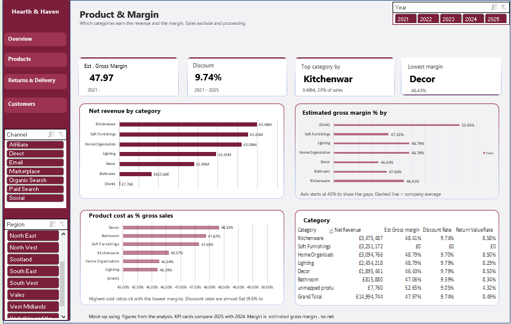

# Retail Performance Analysis for Hearth & Haven UK: Where Margin and Returned Revenue Are Lost

An Excel analysis and four-page interactive dashboard (Power Query, Excel Data Model, DAX measures, PivotTables, slicers) built from five years of order data. All data is synthetic and the company is fictional, created for portfolio use.

## Project Background

Hearth & Haven UK is a fictional online retailer of home goods: kitchenware, soft furnishings, lighting, decor, bathroom and home organisation products. It sells through seven channels (organic and paid search, direct, email, social, marketplace and affiliate) and ships by Standard, Express or Click & Collect. Between 2021 and 2025 it took about 93,000 sales orders (200,000 order lines before cleaning) from 25,000 customers. Net revenue over the period was £14.99M, with an average order value of £161, an estimated gross margin of 48% and returns equal to 8.5% of net revenue.

 Revenue has barely moved since 2021, and management wants to know where the business is giving value away and what to examine first. I set out to answer seven questions:

1. How did revenue, orders and estimated margin change by month and year, and does the year have a consistent shape?
2. Which categories, products and suppliers earn more margin than others, and why?
3. What does discounting do to margin and to the size of an order?
4. How large are returns, what do customers say about them, and are they concentrated anywhere?
5. How long does delivery take, and does it differ by shipping method, region or month?
6. Do customer segments behave differently?
7. Which data-quality problems changed the numbers, and what data is missing?

Insights and recommendations are provided on four key areas, one for each dashboard page:

- **Sales trends, seasonality and channels:** Dashboard page 1
- **Products, margin and discounts:** Dashboard page 2
- **Returns and delivery:** Dashboard page 3
- **Customers and channels:** Dashboard page 4

The interactive Excel dashboard can be downloaded here: [HearthHaven_Portfolio_Dashboard.xlsb](HearthHaven_Portfolio_Dashboard.xlsb) (see [Using the workbook](#using-the-workbook)).

The cleaning steps, data dictionary, KPI definitions and issue log are in [HearthHaven_Documentation.xlsx](docs/HearthHaven_Documentation.xlsx).

The full written analysis is in the [findings report](docs/Findings_Report.pdf), and a shorter write-up is in the [case study](docs/Case_Study.pdf).

## Data Structure and Initial Checks

The data came as four related tables, linked in the Excel Data Model with a Calendar table:

- **Order items:** 200,000 rows. One row is one order line, with quantity, price, discount, net revenue, estimated cost and any return.
- **Orders:** 100,000 rows. One row is one order, with date, status, channel, shipping method and customer.
- **Customers:** 25,000 rows. One row is one customer, with region and segment.
- **Products:** 420 rows. One row is one product, with category, subcategory and supplier.

I checked row counts, duplicate keys, missing values, formats, impossible dates and broken links between tables before analysing anything. The raw file was never edited, and every fix is a recorded Power Query step. The checks found 27 log entries. The ones that changed the numbers were:

| Check | Result | Effect |
|---|---|---|
| Duplicate order lines | 80 | -£5,883 net revenue (0.04%) |
| Dates written day first among year-first dates | 35 | 18 sales orders (£2,916) would have fallen into a blank year |
| Order status spelled several ways | 67 | Five cancelled or processing orders (£682) were counted as sales until fixed |
| Cancelled and Processing orders | 7,009 orders | Excluding them from sales moved net revenue by £1.13M (7.0%) |
| Order lines with no matching product | 110 | £7,760 (0.05%), kept as "unmapped" |
| Orders with no customer ID | 180 | 172 sales orders, £28,172, left out of customer metrics |
| Product names that repeat | 420 products, 223 names | Rankings use the product ID |

The full log is in the [documentation workbook](docs/HearthHaven_Documentation.xlsx).

## Hypotheses and How They Held Up

The five starting hypotheses come from the project brief. I tested each one against the cleaned data.

| # | Hypothesis | Verdict | What the data showed |
|---|---|---|---|
| 1 | Revenue and orders vary by season, channel, region or category | **Partly supported** | Season matters, but every category and channel has the same shape, and yearly revenue is flat |
| 2 | Discounting supports volume but reduces margin | **Margin: supported. Volume: not shown** | Margin falls 17 points across the discount range, with no larger baskets |
| 3 | Returns are concentrated in particular products, categories, channels or delivery outcomes | **Mostly not supported** | Spread widely; only Paid Search stands out |
| 4 | Delivery performance differs by shipping method, region or period | **Not supported, and dropped** | 5.7 days for every method, region and month, so I dropped it as an explanation for anything else |
| 5 | Reference data has quality problems that affect accuracy | **Supported** | 27 log entries; three of them moved headline numbers |

Hypotheses 3 and 4 did not hold up, and that is a useful result: the business should not spend effort hunting for a few problem products or a slow shipping method.

## Executive Summary

### Overview of Findings

Revenue was flat between 2021 and 2025 (£2.97M to £3.02M), so the opportunity is in how the business earns and keeps revenue, not in growth of the total. Three things matter most: a third of revenue (32%) arrives in October to December; deeper discounts cut margin by about 17 points without larger baskets, and category and supplier margin gaps come from product cost relative to price; and returns cost £1.27M (8.49% of net revenue), with 59% of it citing reasons the business can influence.

## Insights Deep Dive

### Sales trends, seasonality and channels

- **Revenue is flat.** Net revenue grew from £2,974,639 in 2021 to £3,024,041 in 2025 (+1.7% in four years). Orders rose from 18,513 to 18,659 and average order value from £160.68 to £162.07, so neither volume nor basket size is moving.
- **Every category and channel follows the same year.** October to December brings 32.3% of revenue and January and February only 12.2%. December is 1.95 times January overall, and between 1.85 and 2.10 times in every category and channel. Most of the differences between groups are within normal variation.
- **January and February are growing slightly faster than the year (+5.6% from 2021 to 2025, against 1.7%).** In 2025 January orders rose 5.2% on 2024 while February orders fell 6.1%, so part of the January gain looks like timing between the two months.
- **Channels and regions differ in volume, not value.** Organic Search (£3.59M, 24%) and Paid Search (£3.00M, 20%) bring in 44% of revenue, and South East, London and North West bring in 44%. Average order value stays between £159.73 and £162.12 across channels, and margin between 47.8% and 48.4%.

The page 1 snapshot is shown in the Executive Summary above.

### Products, margin and discounts

- **Deeper discounts cut margin without larger baskets.** Estimated gross margin falls from 53.0% at full price to 49.0%, 43.3% and 35.8% in the 5 to 10%, 15 to 20% and 25 to 30% discount bands. Units per line stay at 1.40 to 1.41 in every band, and product cost per line stays at about £42, so the lost margin comes entirely from the lower selling price.
- **Discounting is steady and widespread.** About 63% of order lines are discounted in every year, 13% of them at 25 to 30%, and the weighted discount rate stays near 9.74%.
- **Category margin differences come from cost.** Margin runs from 46.4% (Decor) to 48.8% (Home Organisation and Lighting). At full price Decor (51.6%) and Bathroom (52.1%) are still the lowest. Product cost as a share of gross sales value is highest for Decor (48.3%) and lowest for Lighting (46.2%). Kitchenware is the largest category (£3.48M, 23% of sales).
- **Supplier margins differ because of cost, too.** The eight suppliers each provide 11% to 14% of revenue, with margins from 45.9% to 50.0%. Category mix explains only about 0.4 points of that gap and discount mix is almost identical, while cost ratios (45.1% to 48.9%) line up with the margin ranking. The gap is worth about 1% of total margin.

### Returns and delivery

- **Returns total £1.27M (8.49% of net revenue) and over half cite reasons the business can influence.** Changed Mind is £348,646 (27.4%), Not As Described £276,706 (21.7%), Damaged £201,060 (15.8%), Other £171,813 (13.5%), Late Delivery £160,843 (12.6%) and Wrong Item £114,285 (9.0%). The four influenceable reasons total £752,894 (59%), or £592,051 (46.5%) without Late Delivery.
- **Returns are spread widely.** The ten products with the most returned value hold only 6.2% of it, and category return rates sit between 8.3% and 8.6%. Lighting fills six of the top ten places because it sells at about £100 per unit, not because its return rate is high (it is the lowest at 8.29%).
- **Paid Search is the one channel clearly above average.** Its return value rate is 9.02% against 8.49% overall, and 10.9% of its order lines include a return against 10.4% elsewhere, worth roughly £16K.
- **Delivery looks the same everywhere, and late-delivery returns do not match slower deliveries.** Average lead time is 5.7 days for every shipping method, region and month, even though Express costs £7.01 in shipping on average against £2.25 for Standard. Orders with a late-delivery return took 5.72 days to arrive against 5.70 for other returns.

### Customers and channels

- **Almost every customer bought.** 24,393 of 25,000 customers placed at least one sales order, averaging 3.8 orders each. 90.7% placed more than one over the five years, but this is a cumulative figure for buyers only, not an annual retention rate.
- **The four segments behave alike.** Average order value is £160.81 to £161.70 and repeat rate 90.4% to 91.0% in every segment, so the labels do not describe different spending or loyalty.
- **Segments differ in size, not in behaviour.** Everyday Shopper brings in about 38% of revenue, Value Seeker 30%, Home Improver 22% and Premium Buyer 10%.
- **Some orders cannot be linked to a customer.** 172 sales orders (£28,172, 0.2% of revenue) have no customer ID, so they are excluded from customer, region and segment views.

## Recommendations

These are proposals to test, not confirmed fixes. Based on the insights above, I would recommend the following teams consider:

**Merchandising and Finance**

- Margin falls about 17 points between full price and the 25 to 30% band, with no larger baskets. **Test the deeper discount bands on a sample of products against similar products left unchanged, before extending them.**
- Decor and Bathroom have the highest cost ratios and lowest margins even at full price, and supplier margins differ by 4 points. **Replace estimated costs with real costs for the weakest categories and suppliers, then review pricing and sourcing.**

**Customer Experience, Merchandising and Operations**

- Not As Described, Damaged and Wrong Item account for £592K of returned value. **Audit listings and photos for the products returned as Not As Described, and check damage and picking records for the rest.**

**Operations**

- Lead time is the same for every shipping method, Express costs £4.76 more per order, and late-delivery returns do not match slower deliveries. **Record a promised delivery date for each order and check what Express promises, so on-time delivery becomes measurable.**

**Head of E-commerce**

- 32% of revenue arrives in October to December in every category and channel. **Plan stock, staffing, returns handling and marketing around the peak, and test ways to lift January and February (12.2% of revenue today).**

**Data owner**

- The data had 27 log entries and cannot answer questions about marketing return, conversion, stock or promised delivery. **Fix capture at source (unique product codes, a customer ID on every order, consistent date formats, quantity checks) and add advertising spend, stock levels and a promised delivery date.**

Owners, expected mechanisms and success metrics for each recommendation are in the [findings report](docs/Findings_Report.pdf).

## Assumptions and Caveats

Throughout the analysis, several assumptions were made to manage problems with the data:

- **Sales exclude Cancelled and Processing orders.** This moved net revenue by £1.13M. Returned and Partially Returned orders count as sales, and returns are reported separately.
- **Dates written day first (35 of them) were read as UK dates.** Otherwise 18 sales orders would have dropped out of the yearly totals.
- **80 duplicate order lines were removed**, and 250 blank discount rates were recovered from the discount and gross values.
- **160 lines have zero quantity and 10 return more units than were ordered.** They were kept and flagged, and affect units per line and the returned unit rate only slightly.
- **110 lines for one missing product code (0.05% of sales) are shown as "unmapped"** and left out of category and product views.
- **172 sales orders have no customer ID** and are excluded from customer, region and segment metrics.
- **12 orders show delivery before the order date.** Their lead time was set to blank.
- **Margin is estimated gross margin** (net revenue less estimated product cost). It is not profit, because the data has no overheads, marketing or fulfilment cost.
- **The data has no advertising spend, web traffic, stock levels or promised delivery dates**, so marketing return, conversion, stockouts and on-time delivery cannot be measured.
- **Patterns are associations, not proven causes.** Return reasons are what customers said. Several differences between small groups are within normal variation, and the very uniform delivery times should be verified with the data owner.

## Using the workbook

1. Download `HearthHaven_Portfolio_Dashboard.xlsb` and open it in the **Excel desktop app for Windows**. It is saved as an Excel Binary Workbook (.xlsb) to keep the file small, and the Data Model may not work in Excel for the web or some Mac versions.
2. Start at Dashboard 1 and use the sidebar buttons to move between pages.
3. Use the slicers (Year, Channel, Region, Category) to filter. Click the funnel icon on a slicer to clear it.

The workbook keeps its own copy of the data, so the dashboard works without the raw file.

## Repository contents

| Path | What it is |
|---|---|
| `HearthHaven_Portfolio_Dashboard.xlsb` | The final workbook: dashboards, calculations and documentation sheets |
| `docs/Findings_Report.pdf` | Findings, limitations and recommendations |
| `docs/Case_Study.pdf` | Short portfolio write-up |
| `docs/HearthHaven_Documentation.xlsx` | Issue log, data dictionary, KPI definitions, assumptions, hypotheses |
| `images/` | Dashboard and data model screenshots |

## Author

**Favour Daniel**  
[LinkedIn](add-link-here)
