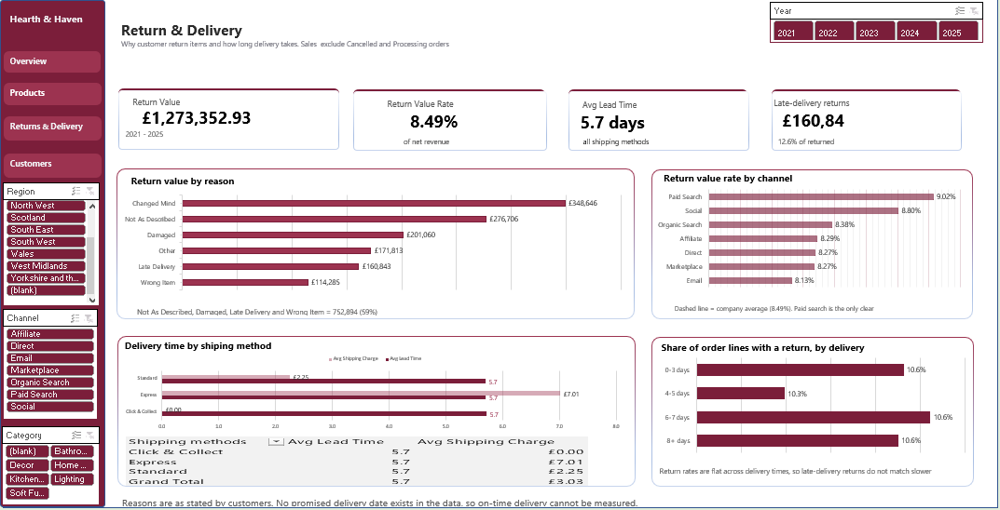
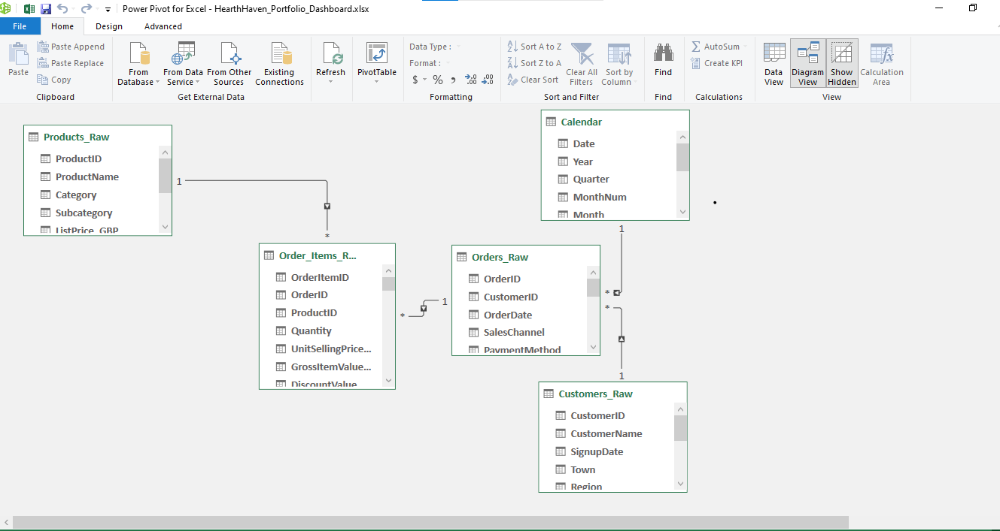

# Retail Performance Analysis for Hearth & Haven UK: Where Margin and Returned Revenue Are Lost

An Excel analysis and four-page interactive dashboard built with Power Query, the Excel Data Model, DAX measures, PivotTables and slicers. It tests five starting hypotheses on five years of order data and ends with recommendations the business can test.

> **Data note:** the company and all data are fictional and synthetic, created for portfolio use.

## Business context

Hearth & Haven UK is an online retailer of home goods (kitchenware, soft furnishings, lighting, decor, bathroom and home organisation). Between 2021 and 2025 it took about 100,000 orders (200,000 order lines) from 25,000 customers. Revenue has barely changed, and management wants to know where the business is giving value away and what to look at first. Four groups need answers: the Head of E-commerce, the Merchandising Manager and Finance lead, Customer Experience and Operations, and the people who must trust the numbers.

## Business questions

1. How did revenue, orders and estimated margin change by month and year, and does the year have a consistent shape?
2. Do some categories, products or suppliers earn more margin than others, and why?
3. What does discounting do to margin and to the size of an order?
4. How large are returns, what do customers say about them, and are they concentrated anywhere?
5. How long does delivery take, and does it differ by shipping method, region or month?
6. Do customer segments behave differently?
7. Which data-quality problems changed the numbers, and what data is missing?

## Hypotheses

The five starting hypotheses come from the project brief. I tested each against the data after cleaning it.

1. Revenue and order trends vary by season, channel, region or category.
2. Discounting may support sales volume but may also reduce margin.
3. Returns are concentrated in particular products, categories, channels or delivery outcomes.
4. Delivery performance differs by shipping method, region or period.
5. The reference data has quality problems that affect reporting accuracy.

## Testing the hypotheses

| # | Verdict | What the data showed |
|---|---|---|
| 1 | **Partly supported** | Season matters: October to December is 32% of revenue and December is about twice January. But every category and channel follows the same shape, and yearly revenue is flat (+1.7% in four years). |
| 2 | **Margin: supported. Volume: not shown** | Margin falls from 53.0% at full price to 35.8% in the deepest discount band. Units per line stay at 1.40 to 1.41, so there is no sign of bigger baskets. |
| 3 | **Mostly not supported** | The ten products with the most returned value hold 6.2% of it, and category rates are 8.3% to 8.6%. Only Paid Search stands out (9.02% against 8.49%). |
| 4 | **Not supported, and dropped** | Lead time is 5.7 days for every shipping method, region and month. I dropped it as a driver of anything else, and flagged the uniformity as something to verify. |
| 5 | **Supported** | The issue log holds 27 entries. The ones that mattered were the sales basis (£1.13M), a date-format fault (18 orders) and repeated product names. |

Hypotheses 3 and 4 did not hold up, and that is a useful result: it means the business should not spend effort hunting for a few problem products or a slow shipping method.

## Executive summary

- **Revenue is flat, and the shape of the year is the story.** £2.97M (2021) to £3.02M (2025). Plan stock, staffing and returns handling around October to December.
- **Deep discounts cost margin without larger baskets.** About 63% of lines are discounted every year, and margin falls about 17 points across the discount range. The data cannot show whether discounts bring extra orders, so this needs a controlled test.
- **Margin gaps come from cost relative to price, not discounting.** Decor has the lowest margin and highest cost ratio, and stays lowest at full price. Supplier margins (45.9% to 50.0%) line up with cost ratios the same way.
- **Returns total £1.27M (8.49% of net revenue).** Customers cite reasons the business can influence for 59% of it (46.5% without late delivery), so product information, packing and handling are the first places to look.
- **Express costs about £4.76 more per order than Standard but arrives no faster.** Late-delivery returns do not match slower deliveries.
- **Customer segments behave alike**, so the labels do not describe different spending or loyalty.

## What I recommend investigating

1. Test the deeper discount bands on a sample of products before extending them.
2. Replace estimated costs with real costs for the weakest categories and suppliers.
3. Audit the avoidable return reasons (Not As Described, Damaged, Wrong Item: £592K).
4. Record a promised delivery date and check what Express promises.
5. Plan capacity and marketing around the October to December peak.
6. Close the data gaps at source.

Owners, expected mechanisms and success metrics are in the [findings report](docs/Findings_Report.pdf).

## How I approached it, and why

- **Power Query for cleaning.** Every fix is a recorded, repeatable step, and the raw data is never edited, so each change can be audited.
- **Excel Data Model with a Calendar table.** Four related tables can be analysed together without lookups, and every KPI can be filtered by year, month or quarter.
- **DAX measures for KPIs.** One definition per KPI means every slicer and page returns the same number. I wrote 12 definitions before building a chart, and chose not to calculate on-time delivery because the data has no promised delivery date.
- **PivotTables for analysis.** Each number can be traced back and checked against the raw data.
- **Slicers and four pages.** Each page serves one audience and filters consistently.

### Problems I solved

- **A date-format trap:** 35 dates were written day first and an automatic month-first conversion blanked 18 sales orders (£2,916) from the yearly totals. I fixed it by parsing UK dates first.
- **A sales flag built in the wrong order:** five cancelled or processing orders (£682) counted as sales until I moved the logic into the measures.
- **Repeated product names:** 420 products share 223 names, so rankings use the product ID. Ranking by name made returns look about twice as concentrated.

## Business rules and limits

- Sales exclude Cancelled and Processing orders. Returned and Partially Returned orders count as sales, and returns are reported separately.
- Margin is **estimated gross margin** (net revenue less estimated product cost). It is not profit.
- The extract has no advertising spend, web traffic, stock levels or promised delivery dates, so marketing return, conversion, stockouts and on-time delivery cannot be measured.
- Patterns are associations, not proven causes, and some differences between small groups are within normal variation.

## Using the workbook

1. Download `HearthHaven_Portfolio_Dashboard.xlsb` and open it in the **Excel desktop app for Windows**. It is saved as an Excel Binary Workbook (.xlsb) to keep the file small, and the Data Model may not work in Excel for the web or some Mac versions.
2. Start at Dashboard 1 and use the sidebar buttons to move between pages.
3. Use the slicers (Year, Channel, Region, Category) to filter. Click the funnel icon on a slicer to clear it.

The workbook keeps its own copy of the data, so the dashboard works without the raw file.

## Repository contents

| Path | What it is |
|---|---|
| `HearthHaven_Portfolio_Dashboard.xlsb` | The final workbook: dashboards, calculations and documentation sheets |
| `docs/Findings_Report.pdf` | Findings, limitations and recommendations |
| `docs/Case_Study.pdf` | Short portfolio write-up |
| `docs/HearthHaven_Documentation.xlsx` | Issue log, data dictionary, KPI definitions, assumptions, hypotheses |
| `images/` | Dashboard and data model screenshots |

## Author

**Favour Daniel**  
[LinkedIn](add-link-here)
